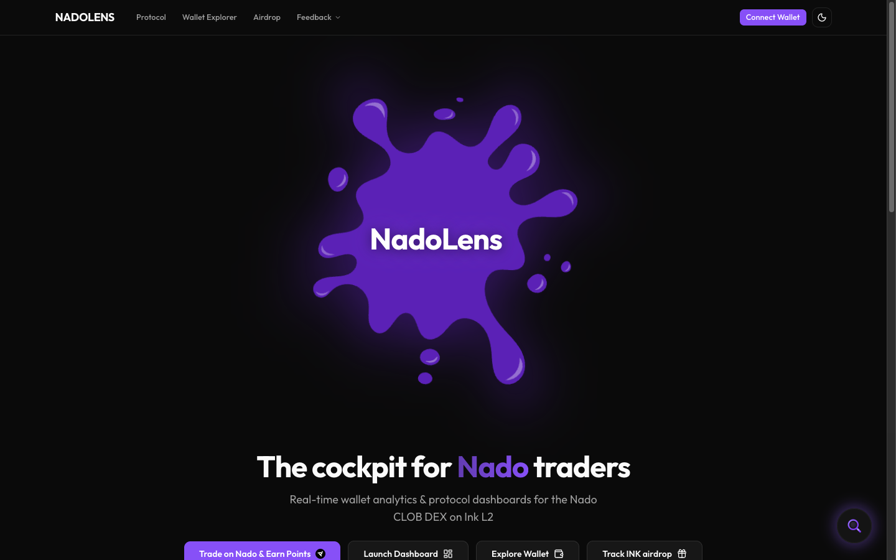
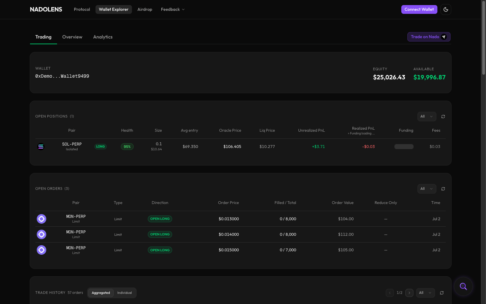
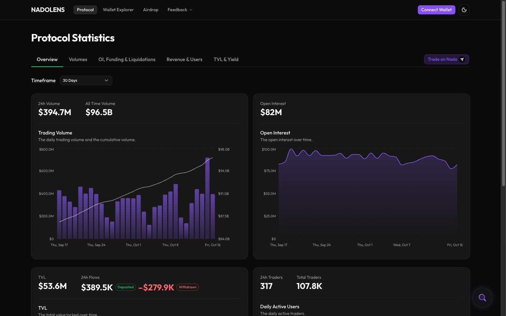

# 🔍 NadoLens

_Real-time on-chain analytics for the Nado protocol on Ink L2_

NadoLens is a portfolio-grade analytics platform that gives traders full visibility into the **[Nado](https://nado.xyz)** CLOB DEX (built by Kraken, deployed on Ink L2). Explore any wallet's positions, trade history, and performance metrics — or dive into protocol-wide volumes, open interest, funding rates, and revenue — all rendered in real-time with streaming data.

---

## 🎨 Technologies Used

| Category | Technology |
|---|---|
| **Framework** | [Next.js 16](https://nextjs.org/) (App Router + Turbopack) |
| **UI Library** | [React 19](https://react.dev/) |
| **Language** | [TypeScript](https://www.typescriptlang.org/) (strict mode) |
| **State** | [Zustand 5](https://zustand.docs.pmnd.rs/) |
| **Validation** | [Zod 4](https://zod.dev/) |
| **Styling** | [Tailwind CSS v4](https://tailwindcss.com/) + [shadcn/ui](https://ui.shadcn.com/) |
| **Web3** | [wagmi 2](https://wagmi.sh/) + [viem 2](https://viem.sh/) + [RainbowKit 2](https://www.rainbowkit.com/) |
| **Charts** | [Recharts 3](https://recharts.org/) |
| **Backend** | [Fly.io](https://fly.io/) (Bun microservices) + [Upstash Redis](https://upstash.com/) |
| **Hosting** | [Vercel](https://vercel.com/) |

---

## 📸 Previews

<p align="center">
  <br><br>
  <br><br>
  
</p>

---

## ✅ Core Features

- **Wallet Explorer** — Live positions, full trade history with aggregated fills, equity curve, win rate & PnL stats, fees & funding breakdown. Three tabs: Overview, Trading, Analytics.
- **Protocol Dashboard** — Protocol-wide analytics across five tabs: Overview, Volumes, OI & Funding, Revenue, TVL. Recharts visualizations with time-range selectors.
- **Real-time Streaming** — SSE via WebSocket proxy on Fly.io for fill events and position changes, with exponential-backoff reconnect.
- **Wallet Connect** — RainbowKit integration with auto-reconnect prefetch and subaccount discovery.
- **Responsive Design** — Mobile-first layout with sticky columns, responsive tables, and collapsible sections.
- **Dark/Light Mode** — next-themes with custom design tokens (`--bull`, `--bear`, `--warn`).
- **Type-Safe** — Zod runtime validation on all API boundaries + TypeScript strict mode throughout.

---

## 🏗️ Architecture

```
Browser ──> Next.js (Vercel) ──> Nado Gateway (real-time)
                |                     |
                |---> nado-matches ----> Nado Archive (history)
                |    (Fly.io fra)
                |         |
                |         └---> Upstash Redis (cache)
                |
                └---> nado-funding ---> Nado Archive (funding)
                     (Fly.io ams)
```

> See [ARCHI.md](ARCHI.md) for detailed architecture documentation, data flow, and component breakdown.

---

## 🔧 Installation & Setup

### 1️⃣ Prerequisites

- **Node.js** >= 20
- **pnpm** >= 10 (`npm i -g pnpm`)
- **Ollama** _(optional, for docs RAG pipeline)_ — [install](https://ollama.com/download), then `ollama pull nomic-embed-text`

### 2️⃣ Clone the repository

```bash
git clone https://github.com/Stachelabs/nadoLens.git
cd nadoLens
```

### 3️⃣ Install dependencies

```bash
pnpm install
```

### 4️⃣ Environment setup

```bash
cp .env.example .env
```

Fill in the required variables:

| Variable | Required | Description |
|---|---|---|
| `NADO_GATEWAY_REST` | Yes | Nado Gateway REST endpoint |
| `NADO_ARCHIVE_REST` | Yes | Nado Archive REST endpoint |
| `NADO_MATCHES_SERVICE_URL` | Yes | nado-matches proxy on Fly.io (fra) |
| `NADO_FUNDING_SERVICE_URL` | Yes | nado-funding proxy on Fly.io (ams) |
| `WS_PROXY_URL` / `NEXT_PUBLIC_WS_PROXY_URL` | Yes | WebSocket-to-SSE proxy URL |
| `SERVICE_SECRET` | Yes | 32-char hex shared secret (Vercel + Fly.io) |
| `UPSTASH_REDIS_REST_URL` / `UPSTASH_REDIS_REST_TOKEN` | Yes | Upstash Redis cache credentials |
| `NEXT_PUBLIC_WALLETCONNECT_PROJECT_ID` | Yes | WalletConnect Cloud project ID |
| `OPENAI_API_KEY` | No | Only for OpenAI embeddings in the RAG pipeline |

> See [.env.example](.env.example) for the full list of variables and descriptions.

### 5️⃣ Start the dev server

```bash
pnpm dev
```

Open [http://localhost:3000](http://localhost:3000) in your browser.

---

## 📜 Available Scripts

| Command | Description |
|---|---|
| `pnpm dev` | Development server (Turbopack) |
| `pnpm build` | Production build |
| `pnpm start` | Start production server |
| `pnpm lint` | Run ESLint |
| `pnpm test` | Run Vitest (CI mode) |
| `pnpm test:watch` | Run Vitest (watch mode) |
| `pnpm docs:build:nado` | Full RAG pipeline: sync, index, verify |
| `pnpm docs:query:nado "<question>"` | Semantic search over Nado docs |
| `pnpm icons:sync-nado-perps` | Sync perp + spot market SVG icons from Nado app (Gateway `/v2/assets` → Playwright) |

---

## 📁 Project Structure

```
app/
  api/
    pairs/                  # Nado pairs list (Gateway proxy)
    wallet/[address]/       # Gateway proxy — subaccount info
    subaccounts/[address]/  # Archive proxy — subaccounts list
    matches/                # Archive proxy — trade history
    funding/                # Archive proxy — interest & funding
    snapshots/              # Account snapshots
    status/                 # Service health check
    protocol/               # Protocol data endpoints
      tickers/              #   Market tickers
      products/             #   Product info
      market-snapshots/     #   OI & volume snapshots
      funding-rates/        #   Funding rate history
      candlesticks/         #   OHLCV data
      insurance-fund/       #   Insurance fund balance
  wallet/[address]/         # Wallet Explorer page
  protocol/                 # Protocol Dashboard page
components/
  landing/                  # Hero, feature cards, footer, live metrics
  wallet/                   # Positions, trades, stats, equity curve, funding charts
  protocol/                 # Overview, volumes, OI & funding, revenue, TVL tabs
  ui/                       # shadcn/ui primitives + custom loaders
hooks/                      # Data-fetching hooks (useWalletData, useProtocolData, etc.)
store/                      # Zustand stores (pairs, protocol, wallet, cache)
lib/
  schemas/                  # Zod schemas — source of truth for all Nado types
  wallet/                   # Trade aggregation, performance calculations
  api/                      # API client helpers
  docs-rag/                 # RAG pipeline (crawler, chunker, embeddings, SQLite)
types/                      # TypeScript type definitions + x18 BigInt converters
services/
  nado-matches/             # Bun service (Fly.io fra) — matches cache + SSE relay
  nado-funding/             # Bun service (Fly.io ams) — funding proxy
scripts/
  docs-rag/                 # RAG CLI + config
  icons-sync/               # Playwright icon sync (perp + spot)
public/
  icons/perps/              # Perp SVG icons + manifest.json
  icons/spot/               # Spot SVG icons + manifest.json (wire up in lib/spotMeta.ts)
```

---

## 🗺️ Roadmap

- [x] Landing page with live protocol metrics
- [x] Wallet Explorer (positions, trades, stats, equity curve, fees, funding)
- [x] Protocol Analytics Dashboard (5 tabs: Overview, Volumes, OI & Funding, Revenue, TVL)
- [x] WS Proxy + SSE streaming (Fly.io)
- [x] Docs RAG pipeline (crawl, index, semantic search)
- [ ] Open Orders view
- [ ] Share PnL screenshots
- [ ] Chart Tracking with position overlays
- [ ] Telegram notifications

---

## 🌟 Contributing

Contributions are welcome. Fork the repo, create a feature branch, and open a pull request.

---

## 📩 Contact

GitHub: [@Stachelabs](https://github.com/Stachelabs)

---

## 📄 License

[MIT](LICENSE)
